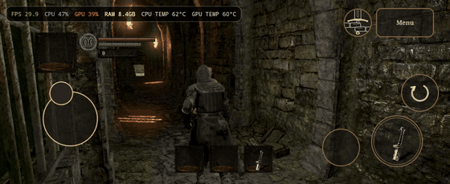
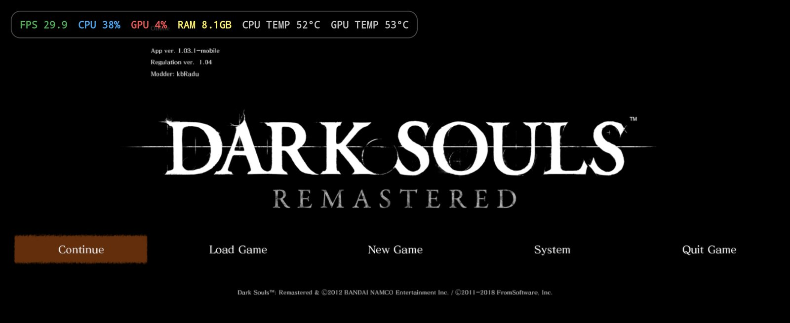
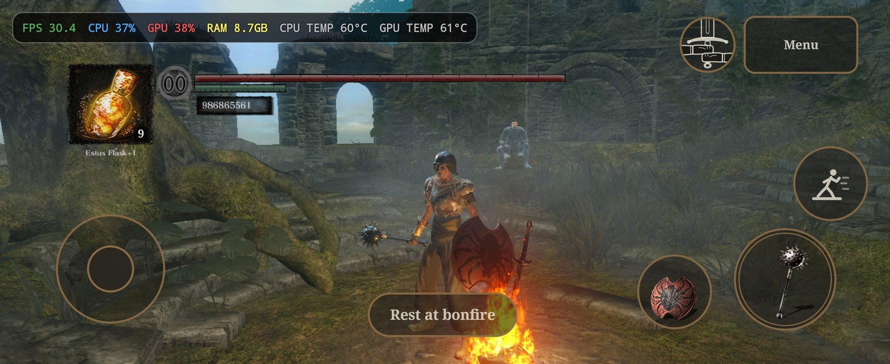
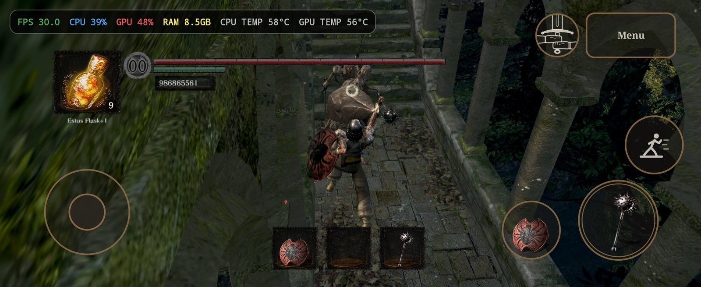
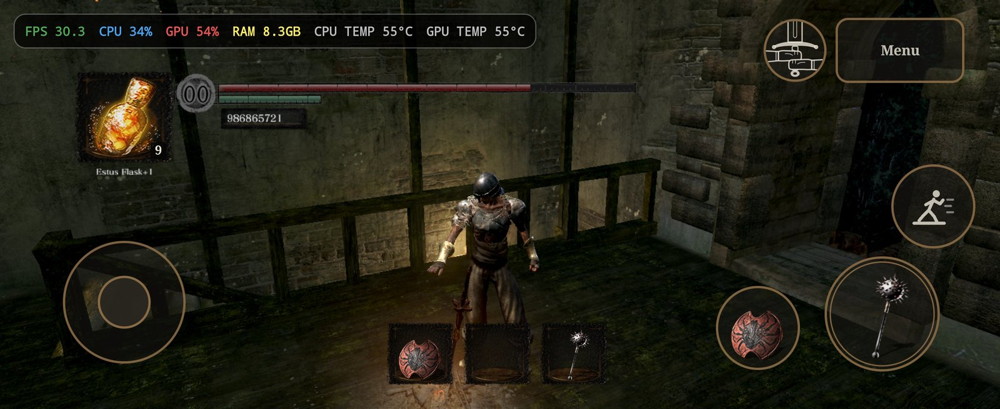
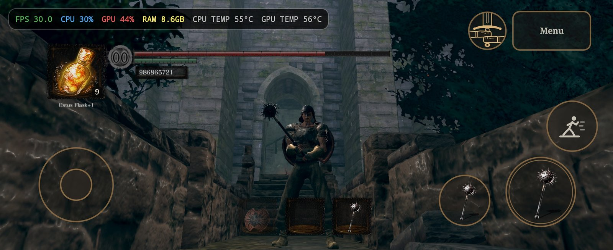
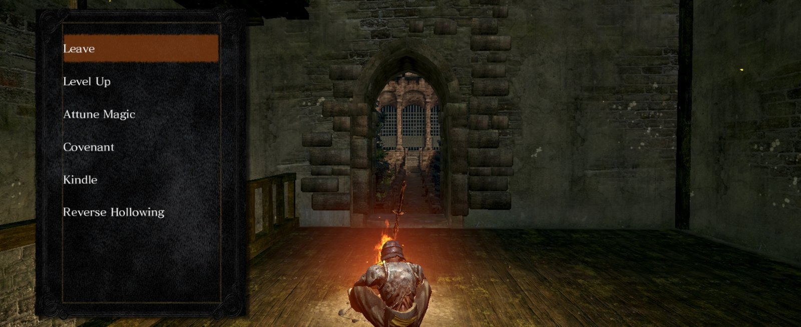
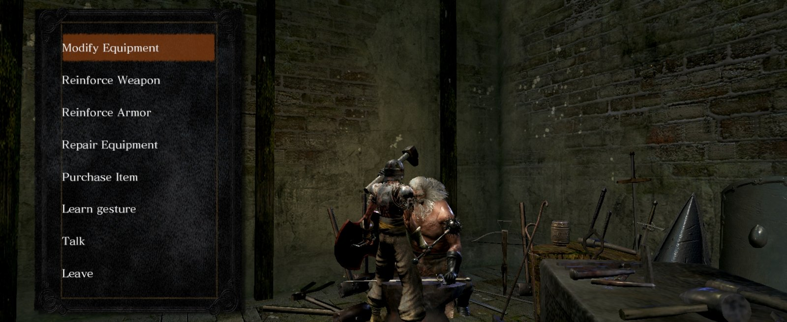

# Dark Souls Remastered on Android

  

> ⚠️ **Work in progress.** Expect bugs, frame drops in some areas and missing polish. More commits will follow.

Runs the PC version of **Dark Souls: Remastered** on an Android phone, with touch controls and a mobile UI. The game runs through Wine + Box64 (x86-64 emulation) inside a modified [OpenNative](https://github.com/RemiPelloux/OpenNative) app. An in-game agent (a `dinput8.dll` proxy) patches the game at run time: speed, frame pacing, menus, HUD.

This repository contains no game files so you should get them yourself.

## Video

**[▶ Full gameplay video (2:15)](docs/media/gameplay.mp4)**

## Screenshots

Galaxy Z Flip6, 30 FPS.

<table>
  <tr>
    <td width="50%"></td>
    <td width="50%"></td>
  </tr>
  <tr>
    <td width="50%"></td>
    <td width="50%"></td>
  </tr>
  <tr>
    <td width="50%"></td>
    <td width="50%"></td>
  </tr>
</table>

## Requirements

| What | Tested |
|---|---|
| Game | **Dark Souls: Remastered (PC), App ver. 1.03.1, Regulation ver. 1.04**. The title screen shows both numbers. `DarkSoulsRemastered.exe` MD5 `878b4603a2cc1ba2cbcd15fc6248e37e`. Other versions are untested; the agent uses fixed addresses of this exe, so another exe version will most likely not work. |
| Phone | Tested only on the Samsung Galaxy Z Flip6 (Snapdragon 8 Gen 3, Adreno 750, Android 16, 2640x1080). Other Android phones should work too, best with a Snapdragon chip (Turnip GPU driver). The touch layout is tuned for 22:9. |
| PC (to build) | Windows with Git Bash, WSL with `mingw-w64` (agent DLL), JDK 17 + Android SDK (app), Python 3.12 + Pillow (asset tools), `adb`. |

## Features

- **Touch controls** made for Dark Souls: movement stick, camera swipe, attack / block / roll / use item, slide-up heavy attack and parry, tap-to-lock-on, two-hand toggle (lit gold while two-handing), item / spell / weapon switch slots with the game's own icons. See [`docs/CONTROLS.md`](docs/CONTROLS.md).
- **Mobile menus**: bigger rows, Back / OK buttons for every menu (bonfire, level up, shops, covenants, settings, character creation), single-tap selection, one-row centred title menu.
- **HUD** moved next to the touch controls (22:9 layout); the touch controls hide in menus and cutscenes.
- **30 FPS cap** with game speed locked to real time (1.00x), also when the frame rate drops.
- **Offline play**, no account or network needed on the phone.

## Controls

| Touch | Action | PS4 |
|---|---|---|
| Left stick (appears where your thumb lands) | Move | L-stick |
| Double-tap the stick and hold | Sprint (jump while sprinting = game input) | ○ hold |
| Drag on free screen | Camera | R-stick |
| Tap on free screen | Lock on / off | R3 |
| Attack button: tap | Light attack | R1 |
| Attack button: slide up and release | Heavy attack | R2 |
| Block button: hold | Block | L1 |
| Block button: slide up and release | Parry | L2 |
| Roll button | Roll / backstep | ○ |
| Estus slot: tap | Next quick item | D-pad ↓ |
| Estus slot: double-tap | Use item | □ |
| Left / middle / right slot | Switch left weapon / spell / right weapon | D-pad ← ↑ → |
| 2H button (gold while two-handing) | Two-hand toggle | △ |
| Prompt pill (e.g. "Rest at bonfire") | Interact | ✕ |
| Menu button | Menu | Options |
| Menus: tap a row / swipe | Select / move the cursor | ✕ / D-pad |
| Menus: Back button | Back | ○ |
| Cutscenes: hold Skip 2 s | Skip | Options |

Details: [`docs/CONTROLS.md`](docs/CONTROLS.md).

## Repository layout

| Path | What |
|---|---|
| `mod/dinput8/` | In-game agent (C, built with mingw): tick / pacer patches, title menu, HUD, input caches. |
| `app/` | The Android app changes: `opennative-dsr.patch` (diff against OpenNative commit `6ff47dfd`) and `apply_patch.sh`. |
| `tools/` | Build and test scripts, game-file tools (`patch_menu.py`, `dark_splash.py`, `extract_assets.py`, `fromsoft/` format readers). |
| `docs/` | How everything works: [`PORTING_GUIDE.md`](docs/PORTING_GUIDE.md) (method), [`PORTING_LOG.md`](docs/PORTING_LOG.md) (history), [`ADDRESSES.md`](docs/ADDRESSES.md) (every game address the port touches), [`DEV_PROCESS.md`](docs/DEV_PROCESS.md) (dev loop). |
| `.track/` | Roadmap per version. |
| `re/` | Reverse-engineering notes. |

## Build

1. **App source**: `bash app/apply_patch.sh local/opennative-src` clones OpenNative at the tested commit and applies the patch.
2. **Box64**: the app expects `local/opennative-src/app/src/main/assets/box86_64/box64-0.4.4-bionic.tzst` (Box64 0.4.4, Android bionic build, packed like the other Box64 packages in that folder). It is not in this repo.
3. **Agent**: `bash tools/build_agent.sh --release` builds `mod/dinput8/dinput8.dll` and copies it into the app assets. Without `--release` you get the dev build with test commands (for example `souls N`).
4. **APK**: `./gradlew :app:assembleLegacyDebug` in `local/opennative-src` (legacy flavor, targetSdk 28), then `adb install -r app/build/outputs/apk/legacy/debug/app-legacy-debug.apk`.
5. **Game files**: copy your game folder to the app's game folder (`CustomGames/DarkSoulsRemastered` in the app data). Then replace two menu files with patched copies made by the tools below:
   - `python tools/patch_menu.py "<game dir>"` → `tools/out/menu.drb.dcx` → `<game>/menu/menu.drb.dcx`
   - `python tools/dark_splash.py "<game dir>" tools/out/menu_2.tpf.dcx` → `<game>/menu/menu_2.tpf.dcx`
   - `python tools/extract_assets.py "<game dir>"` → HUD icons and texts → `<game>/dsr_assets/`

   `tools/batch_test.sh` shows the exact `adb` / `run-as` steps.

## Status

**Still under development.** Playable on the test phone, but more work is needed. Known bugs are tracked in `.track/`.

- Performance is limited by x86 emulation and the phone's thermal throttling. Most areas reach the 30 FPS cap (40–45 FPS uncapped when hot).
- In some locations the frame rate drops below 17 FPS and the game gets laggy.
- Tested only on the Galaxy Z Flip6 (22:9). It was not tested on other phones; other screen ratios may need UI changes.
- A 60 FPS mode exists behind a flag (`dsr_fps60`, see `docs/ADDRESSES.md`).

## Credits and license

- Android app base: [OpenNative](https://github.com/RemiPelloux/OpenNative) by Remi Pelloux (GPL-3, a GameNative / Winlator fork). The patch in `app/` is GPL-3 like its base.
- Runtime: Wine / Proton, Box64, DXVK, Mesa Turnip.
- Dark Souls: Remastered © BANDAI NAMCO Entertainment Inc. / FromSoftware, Inc. This is an unofficial fan project, not affiliated with or endorsed by them.
